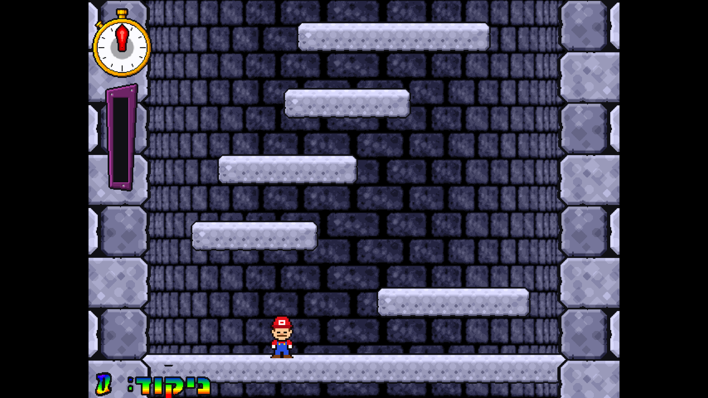
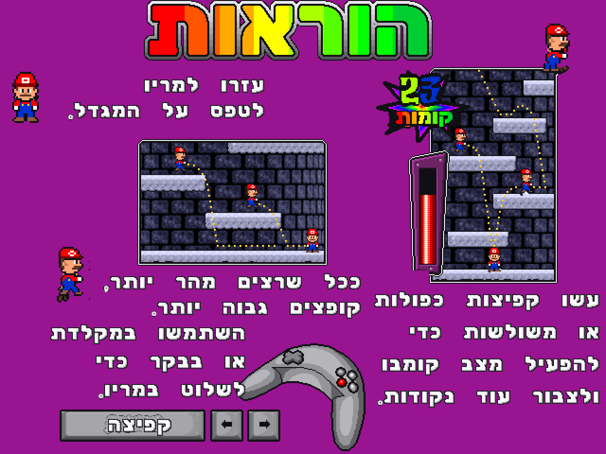

# Icy Tower 1.3.1: Super Mario Edition (עברית, 4K)

גרסת מעריצים לא רשמית של המשחק החינמי **Icy Tower 1.3.1** מאת Free Lunch Design:

- **סופר מריו כדמות הראשית**: דמות משחק מלאה (15 תנועות + צלילי 8-ביט מקוריים), פרצוף ענק במסך הפתיחה (3 הבעות), סמן התפריט, מסך ההוראות, אייקון החלון וה-exe.
- **עברית מלאה**: תפריטים, הודעות, גרפיקה, הוראות ומסמכים (RTL).
- **4K**: התמונה (640×480) מוגדלת למסך מלא בגבולות חדים (nearest-neighbour) בעזרת [cnc-ddraw](https://github.com/FunkyFr3sh/cnc-ddraw). Alt+Enter עובר בין מסך מלא לחלון.

| מסך פתיחה (4K) | משחק (4K) |
|---|---|
|  |  |

## התקנה
מורידים את `icytower13_mario_he_4k_install.exe` מה-[Releases](../../releases) ומריצים. אפשר גם להוריד את ה-zip ולהריץ ישר את `icytower13.exe`.

הגדרות התצוגה נמצאות ב-`ddraw.ini` בתיקיית המשחק:
- `boxing=true`: הגדלה בכפולות שלמות בלבד (2560×1920 ב-4K, פיקסלים אחידים לגמרי).
- `maintas=false`: מתיחה לכל רוחב המסך.
- `shader=`: פילטרים אחרים (xBR, CRT ועוד, מתוך חבילת השיידרים של cnc-ddraw).

## בנייה מהמקור
`build.ps1` בונה את הכול: תיקיית המשחק `work\he_app` ואת ההתקנה ב-`output\`.
צריך Python 3 (pillow, numpy, scipy, pefile), Inno Setup 6 ו-Windows.

קבצי המשחק המקוריים לא נשמרים ב-git. לפני הבנייה צריך להכין:

| נתיב | מה זה |
|---|---|
| `work\extract\app\` | קבצי המשחק המקוריים (מחולצים מ-`icytower13_install.exe`) |
| `work\unpacked\icytower13.exe` | ה-exe המקורי אחרי `upx -d` |
| `work\dl\cnc-ddraw\x\` | שחרור cnc-ddraw (`cnc-ddraw.zip`) |
| `work\tower.cfg.bak` | קובץ הגדרות ברירת מחדל (נוצר בהרצה הראשונה של המשחק) |

| כלי | תפקיד |
|---|---|
| `tools/make_mario.py` | דמות סופר מריו (ספרייטים מרשתות פיקסלים + צלילים) |
| `tools/make_mario_gui.py` | פרצוף הפתיחה, סמן התפריט, מריו במסך ההוראות, אייקון |
| `tools/make_images.py`, `build_data.py`, `hebfont.py` | גרפיקה ופונטים בעברית בתוך `data.dat` |
| `tools/patch_exe.py`, `strings_he.py`, `bidi.py` | מחרוזות עבריות ב-exe (בסדר תצוגה, בסקשן `.heb` חדש) |
| `tools/set_icon.py` | אייקון מריו ב-exe (חייב לרוץ **לפני** `patch_exe.py`) |
| `tools/set_default_char.py` | קביעת הדמות שנבחרת כברירת מחדל ב-`tower.cfg` |
| `tools/ddraw.ini` | הגדרות 4K של cnc-ddraw |

## זכויות
- Icy Tower: © Free Lunch Design (freeware). http://www.freelunchdesign.com
- Mario הוא סימן מסחרי של Nintendo. זוהי עבודת מעריצים שאינה למטרות רווח, ואין לה קשר ל-Nintendo או ל-Free Lunch Design. הספרייטים, הפרצוף והצלילים צוירו ונוצרו מחדש בקוד.
- cnc-ddraw: רישיון MIT, © FunkyFr3sh.
- הפונטים Rubik, Fredoka, Secular One ו-Suez One: רישיון SIL Open Font License.
