# Icy Tower 1.3.1: Super Mario Edition (עברית, HD עד 8K, מחשב + דפדפן + טלפון)

## ▶️ [לשחק עכשיו בדפדפן או בטלפון](https://dor2500.github.io/icy-tower-mario-he-4k/)
**https://dor2500.github.io/icy-tower-mario-he-4k/** · בטלפון אפשר "להוסיף למסך הבית" ולשחק כמו באפליקציה, גם בלי אינטרנט.

גרסת מעריצים לא רשמית של המשחק החינמי **Icy Tower 1.3.1** מאת Free Lunch Design:

- **סופר מריו כדמות הראשית**: דמות משחק מלאה (15 תנועות), פרצוף ענק במסך הפתיחה (3 הבעות), סמן התפריט, מסך ההוראות, אייקון.
- **עברית מלאה**: תפריטים, הודעות, גרפיקה, הוראות ומסמכים (RTL).
- **רק מוזיקה של מריו**: המוזיקה המקורית של Icy Tower (מסך הפתיחה והמשחק) הוסרה.
- **מריו מדבר עברית**: כל הקריאות של המשחק בעברית, בקול גבוה ומלא אנרגיה בסגנון מריו: "טוב!", "יופי!", "אחלה!", "סופר!", "וואו!", "מדהים!", "אקסטרים!", "פנטסטי!", "מושלם!", "אין מצב! יאהו!", "מהר יותר!", "מאמא מיה! המשחק נגמר!".
- **HD עד 8K**: במחשב דרך [cnc-ddraw](https://github.com/FunkyFr3sh/cnc-ddraw) עם שיידר xBRZ. בדפדפן כל הגרפיקה מוגדלת פי 6 ב-xBRZ ומצוירת ברזולוציה של המסך.
- **גרסת HTML לדפדפן ולטלפון**: אותו משחק ואותו עיצוב, עם כפתורי מגע בתחתית המסך.

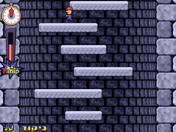

🎬 **[סרטון גיימפליי מלא (44 שניות, 50fps)](docs/gameplay.mp4)**. הסרטון הוקלט מגרסת ה-HTML, מריו משוחק על ידי שחקן אוטומטי, והוא בלי קול.

## ⭐ רמות קושי (HTML + מחשב)
"התחל משחק" פותח בחירת רמה. מאחורי הרשימה מריו משחק בתצוגה חיה של הרמה שנבחרה, עם המפה והמראה שלה (קל: שמיים ועננים, אקסטרים: ערפל סגול ועצמות, בלתי אפשרי: לבה וגיהנום). כל רמה בונה מפה אחרת:

| רמה | רוחב הקומות | קומות חסרות | זיגזג | קומות זזות / מתפוררות | קומה מלאה | מהירות המגדל |
|---|---|---|---|---|---|---|
| ⭐ קל | רחבות מאוד | - | - | - | כל 25 קומות | איטי (עד 3), מאיץ כל 45 שניות |
| ⭐⭐ בינוני | **המשחק המקורי בדיוק** | - | - | - | כל 50 | המקורי |
| ⭐⭐⭐ קשה | צרות | 10% | - | - | כל 100 | עד 6, מאיץ כל 20 שניות |
| ⭐⭐⭐⭐ אקסטרים | צרות מאוד | 20% | כן | 15% זזות | כל 200 | מתחיל מהר, עד 7, כל 15 שניות |
| ⭐⭐⭐⭐⭐ בלתי אפשרי | 3-4 אריחים | 30% | כן | 25% זזות, 20% מתפוררות | רק בהתחלה | עד 8, כל 10 שניות |

כל קפיצה במפה אפשרית: בזיגזג הקומה הבאה נמצאת 6-11 אריחים הצידה, וקומה חסרה (קפיצה של 2 קומות) מופיעה רק מעל קומה רחבה או צמודה לקיר, שיש בה מקום לתנופה. לכל רמה טבלת שיאים משלה. הרמה שנבחרה חלה גם על מצב השלבים (אפשר להחליף במסך השלבים).

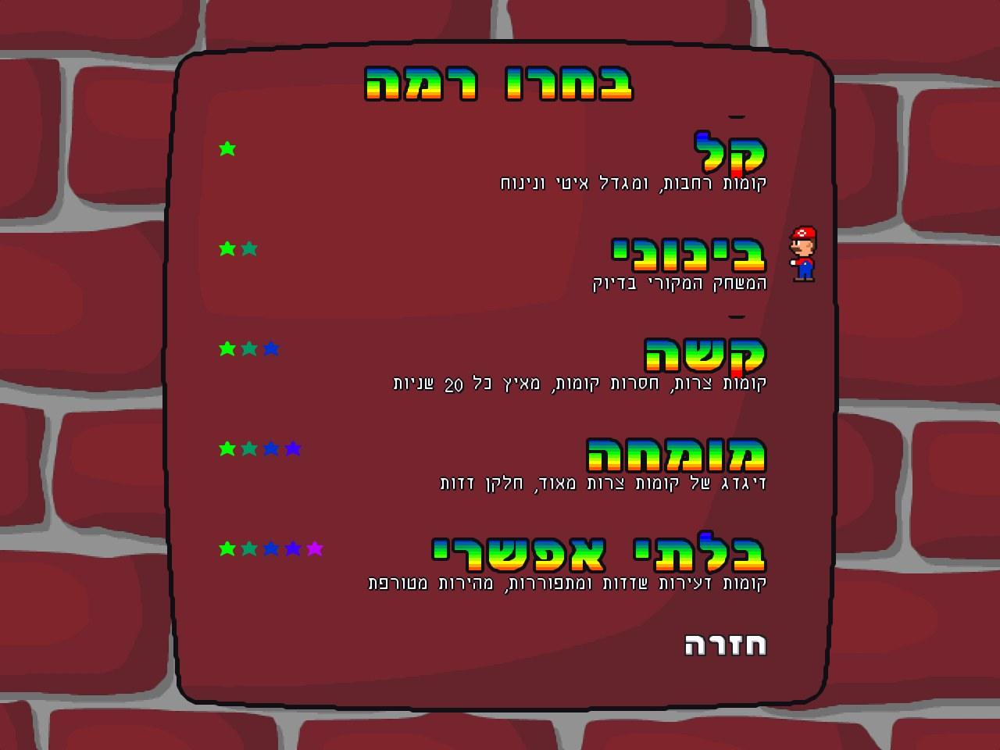

## 🏁 שלבים (HTML + מחשב)
מצב "שלבים" בתפריט: 10 שלבים בסגנון מריו מעל המשחק המקורי. בכל שלב מטפסים עד דגל מריו בקומת היעד, ולכל שלב יש הפתעה משלו.
שלב פותח את השלב הבא, וההתקדמות נשמרת. המשחק הקלאסי נשאר בדיוק כמו המקור.

| # | שלב | ההפתעה |
|---|---|---|
| 1 | ההתחלה | המשחק הרגיל, עד קומה 30 |
| 2 | מטבעות זהב | מטבעות מסתובבים מעל הקומות |
| 3 | קומות נעות | קומות שזזות מצד לצד, ומריו נוסע עליהן |
| 4 | קפיצים | קפיץ שזורק את מריו גבוה בגלגלון |
| 5 | קרח חלקלק | קשה לעצור |
| 6 | קומות מתפוררות | בלוקים של מריו שנסדקים ונופלים אחרי פחות משנייה |
| 7 | רוח חזקה | משבים שמחליפים כיוון ודוחפים את מריו |
| 8 | מגדל בחושך | רואים רק עיגול אור סביב מריו |
| 9 | טירת באוזר | לבה למטה, והמגדל מתחיל מהר ומאיץ כל 18 שניות |
| 10 | הכל ביחד | כל ההפתעות, עד קומה 100 |

| בחירת שלב | קפיצים | חושך | טירת באוזר |
|---|---|---|---|
| 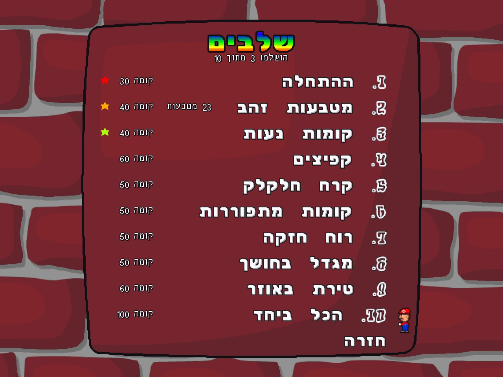 | 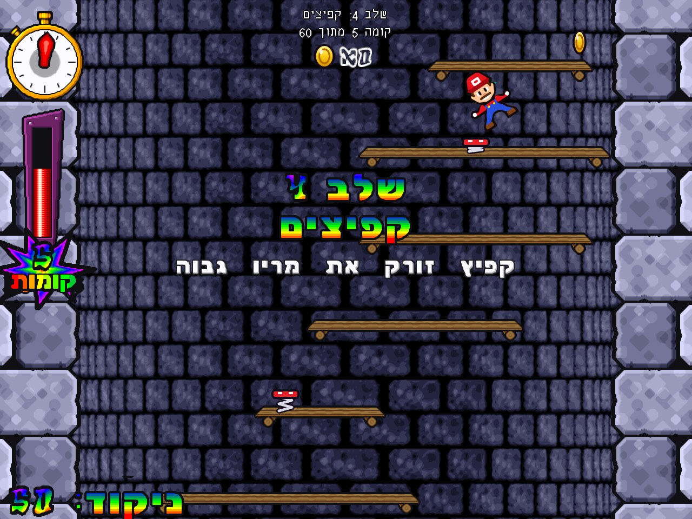 | 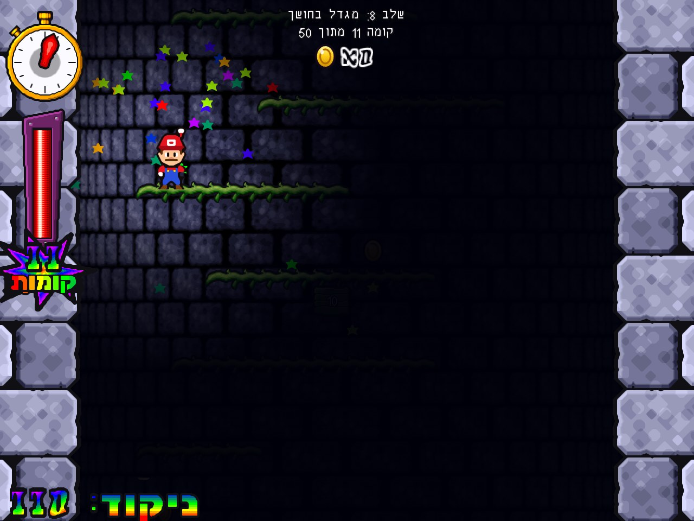 | 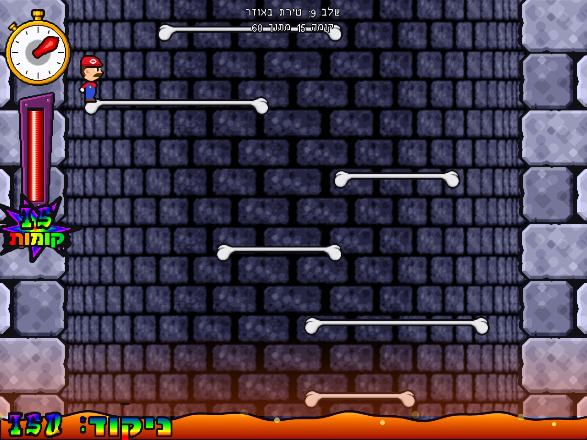 |

## 🎭 דמויות
מסך "דמויות" בתפריט (או "דמות" באפשרויות). הדמות משחקת בכל המצבים, וגם מופיעה במסך הפתיחה.

| משפחת מריו | אורחים ממשחקים אחרים |
|---|---|
| מריו, לואיג'י, מריו האש, וואריו, וואלואיג'י | סטיב והקריפר (מיינקראפט), העז (גוט סימולטור), החללי (אמונג אס), פקמן |

משפחת מריו נצבעת מחדש מהספרייטים של מריו כשהמשחק נטען (`web/js/chars.js`, לפי הפלטה של `tools/make_mario.py`). האורחים מצוירים כווקטורים
בסגנון המשחק (קו מתאר כהה), ולכן הם חדים בכל רזולוציה, עם הליכה, קפיצה, גלגלון, איבוד שיווי משקל בקצה ומצמוץ. הקריפר מהבהב לבן כשהוא בתחתית המסך, ולעז הלשון תמיד בחוץ.

**📸 דמות מתמונה**: הכרטיס האחרון במסך הדמויות, "העלאת תמונה". בוחרים כל תמונה (גם צילום מהטלפון), והמשחק מוחק את הרקע (מילוי מהשוליים עם קצה רך,
ותמונות PNG שקופות נשארות כמו שהן), חותך, מקטין לגודל של מריו, מוסיף קו מתאר כהה בסגנון המשחק ונעליים מצוירות. הדמות הולכת, נמתחת בקפיצה,
עושה גלגלון ומתנדנדת בקצה. היא נשמרת ברזולוציה גבוהה (640 פיקסלים לגובה, חדה גם ב-8K) ונשארת גם אחרי סגירה, בדפדפן ובמחשב (`web/js/custom.js`).
## 🤖 משחק אוטומטי
"משחק אוטומטי" בתפריט: בוחרים רמה והמחשב משחק (`web/js/bot.js`: מנסה עשרות מהלכים על עותק שקט של המשחק ובוחר את הטוב ביותר, כולל ריצה הפוכה וקפיצה מהקיר לתנופה).
כל מקש או נגיעה מחזירים לכם את השליטה באמצע המשחק. אפשר גם להדליק או לכבות אותו בתפריט ההשהיה. משחק אוטומטי לא נכנס לטבלת השיאים.

## 📺 מצב פרסומות
"פרסומות: פועל / כבוי" בתפריט הראשי (או "מצב פרסומות" באפשרויות): באנרים מהבהבים למעלה ולמטה עם "פרסומות" מזויפות (אייפון 27, פטריות כוח 1+1, מיינקראפט 2...).
כל לחיצה על באנר, וגם על ה-X שלו, פותחת את אותו "מבצע" ביוטיוב. המשחק מתכווץ לשטח שבין הבאנרים. בכל באנר יש כפתור "הסרת פרסומות" (אמיתי) שמכבה את מצב הפרסומות.

## 🖥️ המשחק במחשב: הכול בתוך icytower13.exe
מגרסה 1.5, `icytower13.exe` בתיקיית המשחק (וקיצור הדרך "Icy Tower - סופר מריו") הוא המשחק עם כל השינויים: שלבים, רמות קושי, דמויות, משחק אוטומטי, פרסומות והלוגו בעברית.
זו ההעברה הנאמנה של המשחק (אותה פיזיקה ואותם קבועים כמו בקוד המקורי), שרצה במסך מלא בלי דפדפן ובלי אינטרנט. F11 או Alt+Enter עוברים בין מסך מלא לחלון, ו"יציאה" בתפריט סוגרת.
השיאים וההגדרות נשמרים ב-`%LOCALAPPDATA%\IcyMario`.
- **המשחק המקורי משנת 2003** נשאר ליד, בשם `icytower13_classic.exe` (מתורגם, עם מריו, הלוגו והטקסט הרץ בעברית). פותחים אותו מ"אפשרויות" ← "המשחק המקורי (קלאסי)" או מתפריט ההתחלה.
  אי אפשר להכניס שלבים, דמויות או פרסומות לתוך הקוד של המנוע הישן (קוד מכונה מ-2003), ולכן החדש הוא ה-exe הראשי.

**כרטיס מסך**: שני המנועים רצים על הכרטיס החזק (NVIDIA או AMD) גם במחשב נייד עם שני כרטיסים. ההתקנה (וגם המשחק עצמו) כותבת את ההגדרה
"ביצועים גבוהים" של Windows (`HKCU\Software\Microsoft\DirectX\UserGpuPreferences`). ה-WebView2 רץ עם `--force_high_performance_gpu`,
והמנוע הקלאסי מצייר דרך OpenGL. שם הכרטיס שבשימוש מופיע בתחתית מסך האפשרויות.

`icytower13.exe` נבנה מ-`tools/desktop/IcyMario.cs` (WinForms + WebView2, מתקמפל עם ה-csc של .NET Framework 4 שיש בכל Windows). `tools/desktop/build_desktop.ps1` מוריד את ה-SDK של WebView2 מ-NuGet בפעם הראשונה, ו-`build.ps1` מריץ אותו.

## גרסת HTML (דפדפן + טלפון)

| מסך פתיחה | קומבו | אחרי קומה 200 |
|---|---|---|
| 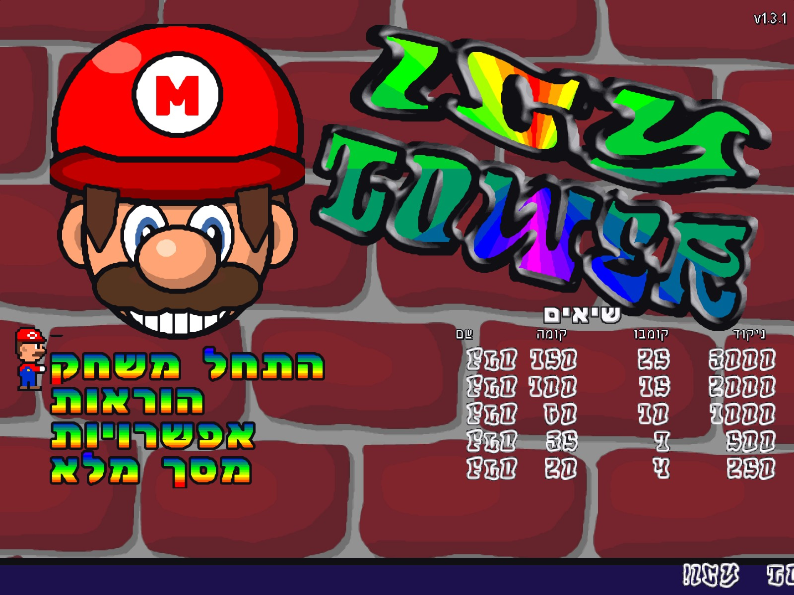 | 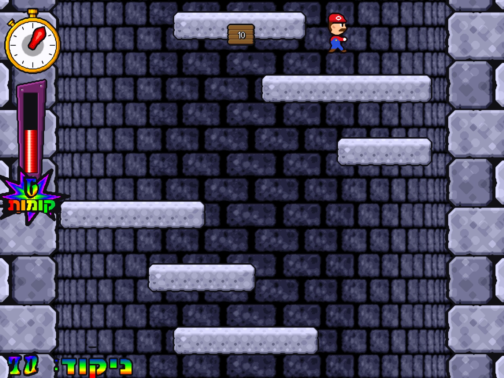 |  |
| **פרס על קומבו + גלגלון** | **אפשרויות** | **הוראות** |
| 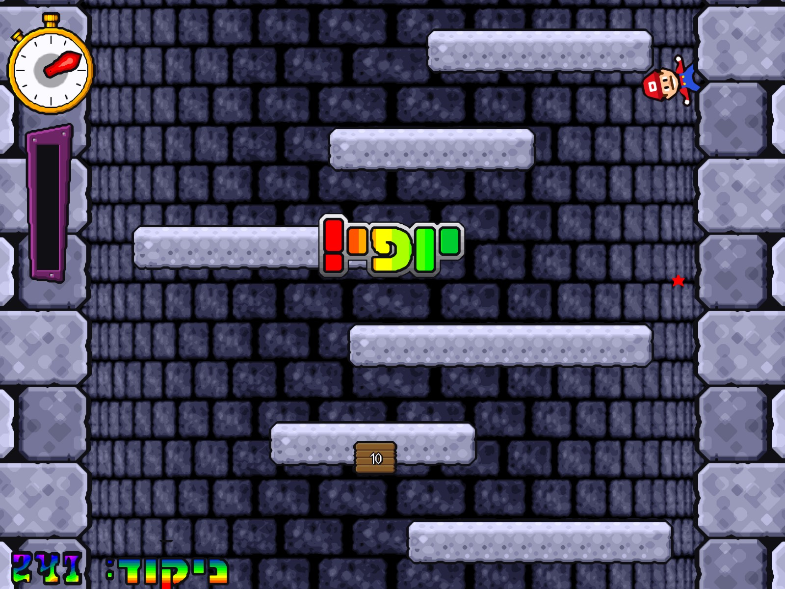 | 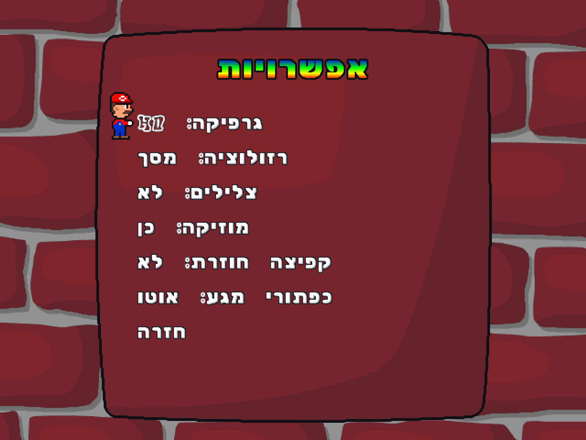 |  |

| טלפון לאורך | טלפון לרוחב |
|---|---|
| 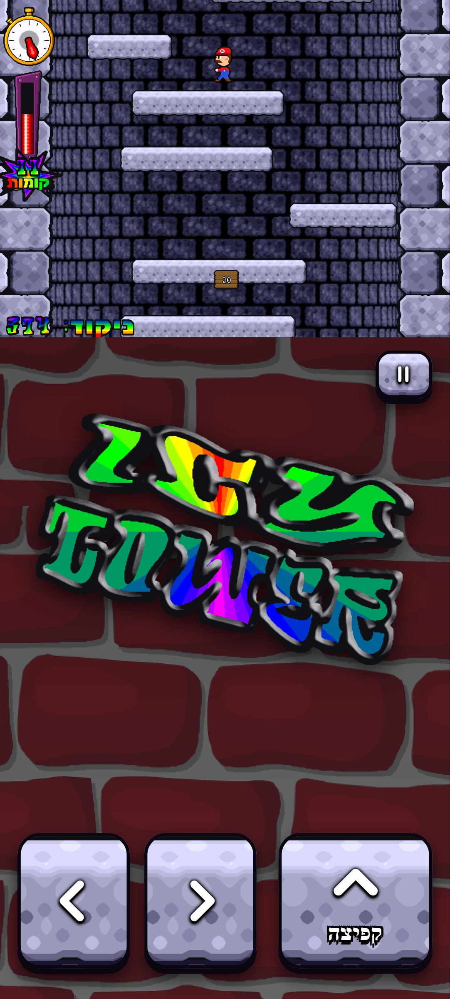 | 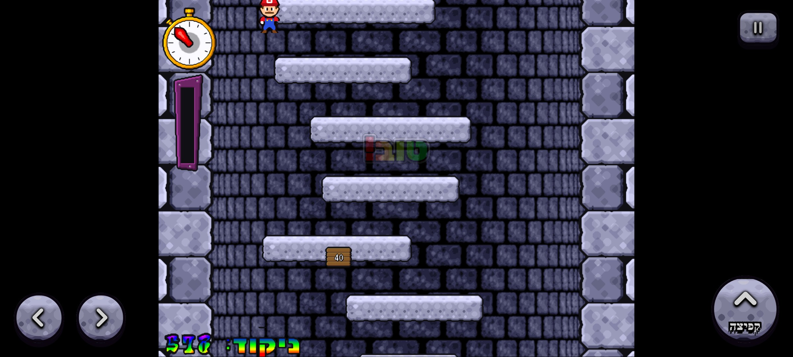 |

| HD (xBRZ פי 6) | פיקסלים קלאסיים (אפשרות בתפריט) |
|---|---|
| 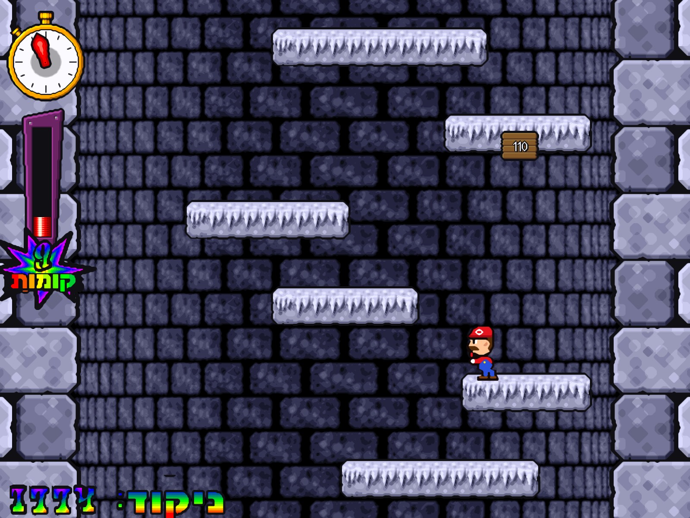 | 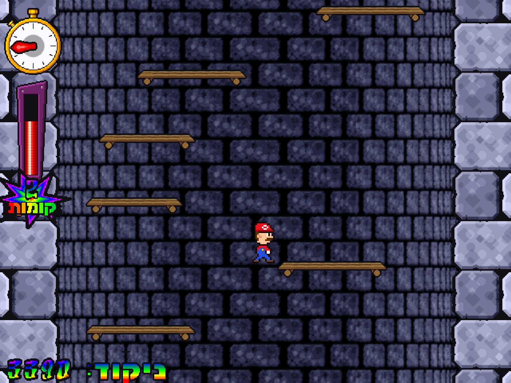 |

**זה אותו משחק, לא חיקוי.** המשחקיות הועברה מתוך קוד ה-exe המקורי (דיסאסמבלי של `icytower13.exe`), עם כל הקבועים המקוריים:
50 טיקים בשנייה, תאוצה 0.3, חיכוך 0.9, קפיצה `-max(12, 2·|מהירות|)`, כוח משיכה 0.8, קירות ב-x=85/555 עם קפיצה מהקיר ×0.9,
קומה כל 80 פיקסלים ורוחב קומות לפי הגובה, קומה מלאה כל 50 קומות, האצת הגלילה כל 30 שניות (0.5→5 פיקסלים לטיק),
גלילה מהירה כשמריו בראש המסך, קומבו (טיימר של 100 טיקים, ניקוד קומות²) ו-10 דרגות פרס. גם הגרפיקה, הפונטים והצלילים
נלקחים ישר מקבצי המשחק, והקיר האחורי המעוקל נבנה באותו אלגוריתם כמו במקור.

- **מקשים**: חצים או A/D לריצה, רווח או חץ למעלה לקפיצה, Esc או P להשהיה. יש תמיכה בגיימפד.
- **טלפון**: בכל פתיחה המשחק שואל איך רוצים לשחק:
  - **מגע מלא**: מסך מלא מלמעלה עד למטה, כמו משחק לטלפון, בלי כפתורים ובלי שורת הכתובת. כשמחזיקים את הטלפון לאורך רואים יותר מהמגדל מעל מריו: השעון ומד הקומבו למעלה והניקוד למטה. לרוחב, קירות המגדל ממשיכים עד קצות המסך. מחזיקים את צד שמאל או ימין כדי לרוץ (מחליקים לצד השני כדי להסתובב), ומחליקים למעלה או נוגעים באצבע שנייה כדי לקפוץ.
  - **כפתורים**: לאורך, התמונה למעלה וכפתורי שמאלה, ימינה וקפיצה למטה. לרוחב, כפתורים עגולים בפינות.
  - אפשר להחליף בכל רגע במסך האפשרויות. במחשב המשחק לא שואל, והכול נשאר כרגיל.
  - באייפון אין מסך מלא בדפדפן: מוסיפים את המשחק למסך הבית ("שיתוף" ואז "הוספה למסך הבית").
- **אפשרויות**: גרפיקה HD או פיקסלים, רזולוציית ציור (מסך / 4K / 8K), צלילים, מוזיקה, קפיצה חוזרת (מחזיקים את הקפיצה), כפתורי מגע, דמות, מצב פרסומות.
- **שיאים** נשמרים בדפדפן. אפשר להתקין כאפליקציה (PWA), והמשחק עובד גם בלי אינטרנט.

**הפעלה**: פשוט פותחים את **[dor2500.github.io/icy-tower-mario-he-4k](https://dor2500.github.io/icy-tower-mario-he-4k/)**.
האתר מתעדכן לבד: הקוד נלקח מ-`web/` והנכסים מה-zip שבשחרור האחרון (`.github/workflows/pages.yml`).
להרצה מקומית: מורידים את `icytower13_mario_he_web.zip` מה-[Releases](../../releases), מחלצים ומריצים `python serve.py`.

## גרסת המחשב (Windows)

| משחק ב-4K (שיידר xBRZ) | מסך פתיחה |
|---|---|
| 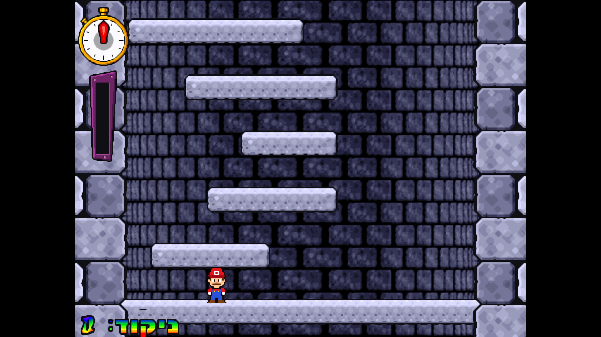 | 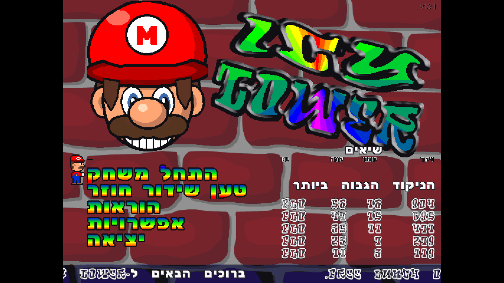 |

מורידים את `icytower13_mario_he_hd_install.exe` מה-[Releases](../../releases) ומריצים. אפשר גם להוריד את ה-zip הנייד ולהריץ ישר את `icytower13.exe`.
Alt+Enter עובר בין מסך מלא לחלון. הגדרות התצוגה נמצאות ב-`ddraw.ini`:
- `shader=Shaders\xbrz\xbrz-freescale-multipass.glsl` (ברירת מחדל): HD חלק בכל רזולוציה (4K, 8K).
- `shader=Shaders\nearest-neighbor.glsl`: הפיקסלים המקוריים, חדים ומרובעים.
- `boxing=true`: הגדלה בכפולות שלמות בלבד. `maintas=false`: מתיחה לכל רוחב המסך.

**מוזיקה**: המוזיקה המקורית של Icy Tower הוסרה (`tools/set_music.py`). קובצי ההקלטה של מריו לא מופצים כאן (Nintendo).
מי שיש לו הקלטות משלו בונה עם `build.ps1 -MarioAudio <תיקייה>`, ואז נושא מריו מתנגן במסך הפתיחה ובמשחק, וגם בגרסת ה-HTML.
בלי ההקלטות המשחק שקט (רק אפקטים).

## בנייה מהמקור
`build.ps1` בונה הכול: תיקיית המשחק `work\he_app` (`icytower13.exe` החדש + `icytower13_classic.exe` המקורי), גרסת ה-HTML ב-`web\assets` וההתקנה ב-`output\`.
צריך Windows, Python 3 (pillow, numpy, scipy, pefile; ל-`record_media.py` גם playwright), Inno Setup 6 ו-ffmpeg.
לגרפיקת ה-HD צריך גם להריץ פעם אחת את `tools\xbrz\build_xbrz.ps1` (דורש Visual Studio Build Tools).

קבצי המשחק המקוריים, והנכסים של גרסת ה-HTML שנגזרים מהם (`web/assets`), לא נשמרים ב-git. לפני הבנייה צריך להכין:

| נתיב | מה זה |
|---|---|
| `work\extract\app\` | קבצי המשחק המקוריים (מחולצים מ-`icytower13_install.exe`) |
| `work\unpacked\icytower13.exe` | ה-exe המקורי אחרי `upx -d` |
| `work\dl\cnc-ddraw\x\` | שחרור cnc-ddraw (`cnc-ddraw.zip`) |
| `work\tower.cfg.bak` | קובץ הגדרות ברירת מחדל (נוצר בהרצה הראשונה של המשחק) |

| כלי | תפקיד |
|---|---|
| `tools/make_mario.py` | דמות סופר מריו (ספרייטים מרשתות פיקסלים + צלילים) |
| `tools/make_mario_gui.py` | פרצוף הפתיחה, סמן התפריט, מריו במסך ההוראות, אייקון |
| `tools/make_images.py`, `build_data.py`, `hebfont.py` | גרפיקה ופונטים בעברית בתוך `data.dat` |
| `tools/patch_exe.py`, `strings_he.py`, `bidi.py` | מחרוזות עבריות ב-exe (בסדר תצוגה, בסקשן `.heb` חדש) |
| `tools/set_icon.py` | אייקון מריו ב-exe (חייב לרוץ **לפני** `patch_exe.py`) |
| `tools/set_default_char.py` | קביעת הדמות שנבחרת כברירת מחדל ב-`tower.cfg` |
| `tools/set_music.py` | הסרת המוזיקה המקורית מ-`sfx13.dat` (או החלפתה בנושא של מריו) |
| `tools/make_voice.py`, `set_voice.py`, `voice/` | הקריינות בעברית: הקראה בקול הנוירוני he-IL-AvriNeural, הגבהה בסגנון מריו והכנסה ל-`sfx13.dat` |
| `tools/import_mario_audio.ps1` | חיתוך ההקלטות שלכם לאפקטים ולנושא בלולאה מדויקת |
| `tools/ddraw.ini` | הגדרות התצוגה (HD / 4K / 8K) של cnc-ddraw |
| `tools/build_web.py` | ייצוא הגרפיקה, הפונטים והצלילים לגרסת ה-HTML, כולל HD פי 6 ב-xBRZ והקיר האחורי |
| `tools/xbrz/` | כלי שורת פקודה ל-xBRZ ותסריט שבונה אותו |
| `tools/serve_web.py` | שרת מקומי בלי מטמון (גם לטלפון ברשת המקומית) |
| `tools/record_media.py` | צילומי המסך והסרטון שב-`docs/` (צעד-אחר-צעד, 50fps) |
| `web/` | גרסת ה-HTML: `js/game.js` (המשחקיות מהמקור), `gfx.js` (ציור עד 8K ופונטים), `main.js` (מסכים ופריסה), `bot.js` (שחקן הדגמה) |

## זכויות
- Icy Tower: © Free Lunch Design (freeware). http://www.freelunchdesign.com
- Mario הוא סימן מסחרי של Nintendo. זוהי עבודת מעריצים שאינה למטרות רווח, ואין לה קשר ל-Nintendo או ל-Free Lunch Design. הספרייטים והפרצוף צוירו מחדש בקוד.
- cnc-ddraw: רישיון MIT, © FunkyFr3sh. השיידרים (xBRZ freescale ועוד): libretro/glsl-shaders.
- xBRZ: © Zenju, רישיון GPL-3.0. משמש רק בזמן הבנייה ליצירת גרפיקת ה-HD, והקוד שלו לא נכלל כאן.
- הפונטים Rubik, Fredoka, Secular One ו-Suez One: רישיון SIL Open Font License.
